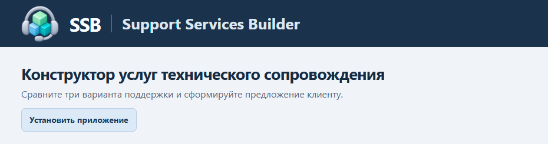

# Руководство пользователя Support Services Builder

**Версия 1.1.0 · 11 ноября 2026 г.**

## 1. Для чего нужен SSB

Support Services Builder помогает собрать предложение по техническому сопровождению. Вы выбираете вариант поддержки, настраиваете состав услуг и выгружаете предложение в Excel или Word. Каталог и настройки обрабатываются в вашем браузере.

## 2. Установка

Откройте HTTPS-ссылку на приложение, которую предоставил владелец SSB. Если в приложении видна кнопка **Установить приложение**, нажмите её и подтвердите установку. Установленный SSB открывается отдельным окном. На Windows его можно найти по названию **Support Services Builder** через поиск в меню «Пуск», если браузер зарегистрировал приложение в системе.

**В Google Chrome**

1. Откройте страницу SSB в обычном профиле Chrome.
2. Нажмите значок установки справа в адресной строке. Также можно открыть меню **⋮ → Трансляция, сохранение и отправка → Установить страницу как приложение**.
3. Подтвердите установку и откройте SSB из списка приложений. [Установка веб-приложений в Chrome](https://support.google.com/chrome/answer/9658361?hl=ru)

**В Microsoft Edge**

1. Откройте страницу SSB в обычном профиле Edge.
2. Нажмите значок установки в адресной строке или откройте **… → Другие инструменты → Приложения → Установить этот сайт как приложение**.
3. Подтвердите установку. В параметрах после установки можно выбрать, где закрепить приложение. [Установка веб-приложений в Edge](https://support.microsoft.com/en-us/edge/install-manage-or-uninstall-apps-in-microsoft-edge)

После первого открытия в сети проверьте, что SSB снова запускается без сети. Для резервной работы распакуйте автономный ZIP и откройте `index.html` из распакованной папки. Для обеих сборок достаточно браузера.

## 3. Первый запуск

1. Раскройте **Настройки источников Confluence**.
2. Введите базовый адрес Confluence, включая часть пути, если она есть в вашем адресе.
3. Заполните **Ключ пространства**, если все источники находятся в одном пространстве. При нескольких пространствах оставьте поле пустым.
4. Укажите метки, которые предоставил владелец каталога, включая метки всех нужных страниц дополнительных разделов.
5. Нажмите **Сохранить источники локально**. После этого появится ссылка **Получить актуальные данные**.

Браузер хранит конфигурацию источников, настройки менеджера и текущий черновик локально. Открывайте SSB в том же профиле браузера и по тому же адресу. Для учебного файла из автономного ZIP используйте метки `demo_catalog`, `demo_defaults` и `demo_intros`. Для импорта готового файла учебный адрес вводить не требуется.

## 4. Обновление каталога

1. Войдите в рабочий Confluence обычным способом.
2. В SSB нажмите **Получить актуальные данные**. Откроется вкладка с ответом Confluence в формате JSON.
3. Сохраните ответ как `.json`. Если браузер предлагает HTML, скопируйте весь JSON в текстовый файл UTF-8 и сохраните его с расширением `.json`.
4. Если в ответе есть `_links.next`, откройте указанную следующую страницу на том же сайте Confluence и сохраните её отдельным файлом. Повторяйте, пока ссылка на продолжение исчезнет.
5. Нажмите **Загрузить JSON**. Выберите все файлы или добавляйте их по одному. Если SSB сообщает о недостающих страницах, загрузите продолжение.
6. Сверьте количество карточек и откройте список предупреждений. При сообщении об отсутствующем стандарте проверьте метку базовой конфигурации.

Пока выгрузка неполная, рабочий каталог остаётся доступен. Если вы начали получать новую выгрузку, **Начать новую выгрузку** очищает только ожидающие страницы.

## 5. Создание предложения

1. При необходимости укажите клиента и название предложения.
2. Выберите вариант для клиента **Standard**, **Extended** или **Managed Service**. В сравнении выбранный вариант помечен как **Предложение**.
3. В таблице включайте услуги для каждого пакета. Для включённой услуги укажите параметр, если он нужен, например количество часов.
4. Снимите отметку **Включить в документ**, чтобы исключить услугу из обоих документов целиком.
5. Откройте **Описание и условия**, чтобы сверить карточку и основную услугу. Модификация имеет собственный ID и настраивается отдельно.

## 6. Состав документа

В блоке **Состав документа** отметьте нужные разделы. Для Word и Excel используется один выбор. Вводный текст берётся из Confluence для выбранного варианта поддержки. Дополнительные разделы изначально выключены. Если раздел недоступен, рядом указана причина.

Для **Матрицы SLA** выберите состав. **Только выбранный уровень поддержки** показывает таблицу пакета предложения. Для **Всех уровней с выделением выбранного** доступны **Отдельные таблицы по уровням поддержки** и **Одна сравнительная таблица**. В таблице отдельного пакета пять временных показателей идут строками, а уровни критичности 10, 20, 30 и 80 — столбцами. В сравнительной таблице каждый пакет занимает свой столбец. В зависимости от представления выделяется таблица пакета предложения или его столбец. **Уровни критичности** можно включить отдельно. В Word они выводятся в таблице. **Матрица RACI** пока недоступна.

## 7. Скачивание документов

- **Скачать Excel** создаёт книгу с листами «Описание услуг» и «Предложение». На втором листе ID и название ведут к описанию на первом листе. Вводный текст размещается на листе «Предложение». Для других включённых разделов создаются отдельные листы.
- **Скачать Word** создаёт документ со сравнением вариантов и описаниями и условиями по включённым услугам. Включённый вводный текст размещается перед сравнением. Остальные отмеченные разделы следуют после описаний.

Найдите файлы в загрузках браузера. Перед отправкой клиенту проверьте выбранный пакет, состав, параметры и вводный текст.

## 8. Локальные настройки и черновик

- **Применить стандарт Confluence** заменяет текущие правки пакетов базовой конфигурацией.
- **Зафиксировать локально** сохраняет текущий состав, параметры пакетов и видимость услуг в документах как настройки менеджера.
- **Восстановить локальные настройки** применяет последнюю сохранённую конфигурацию менеджера.
- **Скачать настройки** создаёт файл для резервной копии. **Загрузить настройки** применяет этот файл в другом профиле или на другом компьютере.

Текущее предложение автоматически сохраняется отдельно от настроек менеджера. Дождитесь надписи **Черновик сохранён на этом устройстве**. При следующем открытии приложение вернёт данные из загруженных источников, выбранный пакет, изменения услуг, параметры, состав документа и настройки матрицы SLA. При смене адреса черновик остаётся в хранилище прежнего адреса. Очистка данных сайта удаляет черновик. Перед переносом экспортируйте настройки и нужные документы.

## 9. Обновления приложения

Версия показана в шапке. В установленном приложении новая версия проверяется в фоне. Нажмите **Проверить обновления**, чтобы проверить вручную. Когда появится **Установить обновление**, завершите текущую операцию и подтвердите перезапуск. SSB сначала сохраняет предложение. После открытия новой версии проверьте надпись о восстановлении черновика и выбранный пакет.

Откройте **Что нового**, чтобы прочитать изменения текущей версии. Если браузер не подтвердил сохранение, приложение предложит отложить перезапуск.

## 10. Частые проблемы

**JSON не загружается.** Проверьте расширение файла и его содержимое. Файл со страницей входа или HTML нужно пересохранить после входа в Confluence.

**Каталог неполный.** Сохраните и загрузите остальные страницы из `_links.next`. Если ссылки уже нет, проверьте пространство, метки и права просмотра.

**Услуги не отображаются.** Откройте сообщения импорта и проверьте, что файл содержит карточки и метки. Сверьте число карточек с источником.

**Документ не формируется.** Загрузите каталог и исправьте подсвеченные параметры. Проверьте папку загрузок и разрешение браузера на скачивание.

**Настройки или черновик не сохраняются.** Проверьте, что вы используете обычный профиль и браузер разрешает хранение данных сайта. Скачайте резервную копию настроек, если эта кнопка доступна. Если ошибка возникла после открытия второй вкладки, продолжайте в той вкладке, которая сохранила черновик первой.

**Обновление не устанавливается.** Проверьте сеть и статус сохранения черновика. Закончите импорт или экспорт, закройте лишние окна SSB и повторите проверку обновлений. При ошибке загрузки продолжайте в открытой версии.
