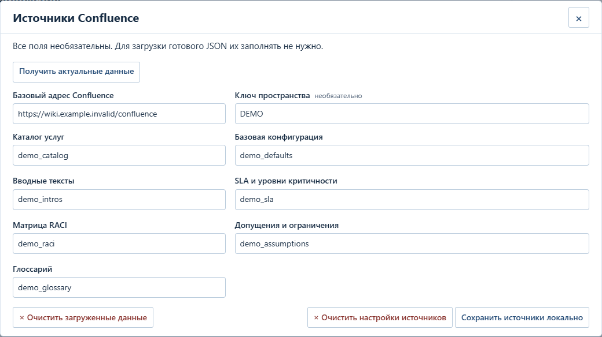
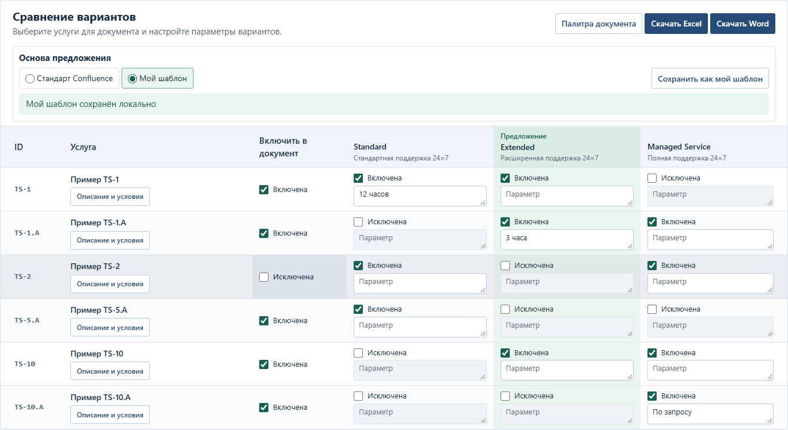
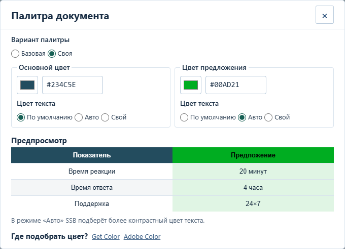

# Руководство пользователя Support Services Builder

**Версия 1.3.0 · 18 ноября 2026 г.**

## 1. Для чего нужен SSB

Support Services Builder помогает подготовить предложение по техническому сопровождению. Загрузите каталог из Confluence, выберите вариант поддержки, настройте услуги и скачайте Excel или Word. Данные обрабатываются локально в браузере. SSB не изменяет страницы Confluence.

В приложении хранится одно текущее предложение. Его черновик сохраняется автоматически. Для повторного использования своей конфигурации есть **Мой шаблон**. Цвета Word и Excel настраиваются отдельно в **Палитре документа**.

## 2. Установка и запуск

Откройте [ssb.melgaf.com](https://ssb.melgaf.com/) в обычном профиле Chrome или Edge. Можно работать во вкладке или установить SSB отдельным приложением.

Если появилась кнопка **Установить приложение**, нажмите её и подтвердите установку. Также можно воспользоваться значком установки рядом с адресом или командой установки в меню браузера. Название и расположение команды зависят от версии браузера: [справка Chrome](https://support.google.com/chrome/answer/9658361?hl=ru), [справка Edge](https://support.microsoft.com/en-us/edge/install-manage-or-uninstall-apps-in-microsoft-edge).

Используйте один и тот же браузер и профиль. Установки в разных браузерах и профилях имеют отдельные данные и могут создавать похожие ярлыки. После установки откройте приложение и закрепите его на панели задач или в меню «Пуск», если браузер предлагает эти действия.

После первого открытия в сети SSB можно использовать без сети: импортировать сохранённый JSON и формировать документы. Для новой выгрузки из Confluence и обновления приложения нужна сеть.

Для резервной автономной работы распакуйте ZIP целиком и откройте `index.html` в Chrome или Edge. Дополнительные программы и локальный сервер не нужны. Хранилище автономной версии зависит от профиля и пути файла: перенос папки или открытие в другом браузере не переносит черновик и шаблон.

## 3. Первый запуск и загрузка данных

1. Войдите в Confluence обычным способом и скачайте готовый JSON с каталогом и нужными разделами.
2. В SSB нажмите **Загрузить JSON**. Если выгрузка состоит из нескольких файлов, выберите их вместе или добавьте по очереди.
3. Под заголовком **Настройки предложения** сверьте количество загруженных услуг. В **Составе документа** проверьте доступные разделы.
4. Настройте предложение и скачайте документы. Для знакомства с интерфейсом можно использовать `examples/demo-confluence.json` из автономного ZIP: это учебный каталог, без рабочих данных.

Предварительно заполнять настройки источников не нужно. Источники определяются по содержимому готового файла. Отсутствующий или пустой необязательный раздел недоступен для включения; это не ошибка. Матрица RACI пока не поддерживается. Если заполненные данные некорректны или подходят несколько страниц, откройте **Источники Confluence** и прочитайте сообщения импорта.

**Источники Confluence** также позволяет необязательно указать адрес Confluence, ключ пространства и метки страниц. Нажмите **Сохранить источники локально**, чтобы сохранить поля между запусками. При заполненных настройках ссылка **Получить актуальные данные** открывает ответ Confluence в новой вкладке; там требуется ваша обычная авторизация. Все поля можно оставить пустыми. Окно закрывается кнопкой × или Escape; закрытие само по себе не сохраняет изменённые поля между запусками.

## 4. Обновление и очистка данных Confluence

Для обновления каталога скачайте свежий JSON и снова нажмите **Загрузить JSON**. Если ответ Confluence содержит `_links.next`, сохраните и загрузите продолжение до последней страницы. Пока выгрузка неполная, прежний каталог остаётся доступен. **Начать новую выгрузку** в окне источников очищает только ожидающие страницы после подтверждения.

После импорта проверьте статус и количество услуг. Если возникла ошибка, ранее загруженные данные не следует считать обновлёнными. Подробности доступны через **Источники Confluence**. При неоднозначном источнике оставьте нужную страницу в файле или уточните сопоставление в настройках источников.

Внизу окна источников находятся две независимые очистки:

- **Очистить загруженные данные** слева удаляет каталог, дополнительные данные и связанную конфигурацию текущего предложения, в том числе из черновика. Личный шаблон, активная и собственная палитра и настройки источников сохраняются. После подтверждения дождитесь **Данные Confluence очищены**. Окно останется открытым. Закройте его и загрузите JSON заново; затем можно явно выбрать **Мой шаблон**.
- **Очистить настройки источников** справа удаляет только сохранённые адрес, пространство и метки и освобождает поля. Каталог и текущее предложение остаются. Дождитесь **Настройки источников очищены**. Готовый JSON по-прежнему можно загрузить без заполнения полей.

Обе операции требуют подтверждения. **Отмена**, × и Escape ничего не удаляют. Если нечего очищать, кнопка неактивна. После успешной очистки каталога он не вернётся при перезапуске; для восстановления нужен исходный JSON. Сохраните этот файл на компьютере. При ошибке хранения SSB не сообщает об успешной очистке.

## 5. Настройка предложения

1. В блоке **Основа предложения** выберите **Стандарт Confluence** или доступный **Мой шаблон**. При замене индивидуальных правок появится подтверждение. Для повторного применения активной основы нажмите на неё ещё раз.
2. Выберите **Standard — Стандартная поддержка 24×7**, **Extended — Расширенная поддержка 24×7** или **Managed Service — Полная поддержка 24×7**. В таблице выбранная колонка выделена и помечена **Предложение**.
3. В колонках пакетов включайте услуги и вводите параметры, например «12 часов». Снятая отметка исключает услугу только из соответствующего пакета; для включённой услуги можно оставить параметр пустым, если уточнение не требуется.
4. В колонке **Включить в документ** снимите отметку у услуги, которую нужно полностью исключить из обоих документов. Состав трёх пакетов при этом сохраняется.
5. Нажмите **Описание и условия**, чтобы прочитать полный текст услуги. Модификации имеют собственные ID и настраиваются отдельно.

Каталог отсортирован по ID: например, TS-2 идёт перед TS-10, модификации — сразу после основного номера. Рабочая область таблицы занимает до 78% высоты окна и меняется вместе с окном. Заголовки остаются видимыми при внутренней прокрутке. На узком экране прокручивайте таблицу горизонтально.

## 6. Состав документа и SLA

В **Составе документа** отметьте нужные разделы: **Вводный текст**, **Матрица SLA**, **Уровни критичности**, **Допущения и ограничения**, **Глоссарий**. Для Word и Excel используется один выбор. Недоступный источник нельзя включить; причина указана рядом.

**Стандарт Confluence** включает все доступные реализованные разделы и выбирает SLA только выбранного пакета. **Мой шаблон** восстанавливает собственный сохранённый состав. Уже открытый черновик сохраняет ваш индивидуальный выбор.

Вводный текст берётся из Confluence для выбранного пакета и размещается перед сравнением вариантов. Редактировать его локально в SSB нельзя.

Для матрицы SLA доступны:

- **Только выбранный уровень поддержки** — одна таблица выбранного пакета. Пять временных показателей расположены строками, уровни критичности 10, 20, 30 и 80 — столбцами.
- **Все уровни с выделением выбранного** — дополнительно выберите **Отдельные таблицы по уровням поддержки** или **Одна сравнительная таблица**. В первом случае следуют Standard, Extended и Managed Service, выбранная таблица выделена; в Excel они находятся на одном листе. Во втором случае пакеты занимают колонки одной таблицы, выбранная колонка выделена и помечена **Предложение**.

Значения и формулировки берутся из Confluence. **Уровни критичности** можно включить отдельно; в Word это таблица. **Матрица RACI** остаётся недоступной.

## 7. Палитра и скачивание документов

Откройте **Палитра документа** в разделе **Сравнение вариантов**.

- **Базовая** использует фиксированные синий и зелёный с белым текстом; эти настройки не редактируются.
- **Своя** позволяет выбрать два основных цвета образцами или ввести HEX, например `#234C5E`. Для каждого заголовка есть **По умолчанию** с белым текстом, **Авто** с автоматическим выбором контрастного текста и **Свой** с отдельным цветом текста.

Предпросмотр меняется сразу. Под предпросмотром постоянно показана подсказка: «В режиме „Авто“ SSB подберёт более контрастный цвет текста». Для подбора цветов можно открыть Get Color или Adobe Color по ссылкам внизу окна.

Корректные изменения сохраняются автоматически, без кнопки сохранения. Переключение на базовую палитру сохраняет собственные цвета и настройки текста; при возврате на **Своя** они восстанавливаются. Закрытие окна, импорт каталога, выбор основы и сохранение шаблона не сбрасывают палитру. Неполный или неверный HEX не заменяет последнее корректное значение. При ошибке хранения не рассчитывайте на сохранение после закрытия приложения.

Документы используют название **Предложение по техническому сопровождению**.

- **Скачать Excel** создаёт листы **Описание услуг** и **Предложение**. На первом — полный каталог с отдельными полями описания и условий. На втором — сравнительная таблица трёх пакетов без колонки описания. ID и название ведут к нужной строке первого листа. Дополнительные включённые разделы получают отдельные листы.
- **Скачать Word** создаёт сравнительную таблицу трёх пакетов и текстовые описания включённых в документ услуг. Названия услуг идут отдельными заголовками без ID, под ними — описания и заполненные условия. Дополнительные разделы следуют после описаний.

Найдите файлы в загрузках браузера. Перед передачей проверьте выбранный пакет, включённые услуги, параметры, разделы и читаемость цветов. Содержимое исходного JSON от выбора палитры не меняется.

## 8. Мой шаблон, черновик и сохранность настроек

**Стандарт Confluence** применяет последнюю загруженную базовую конфигурацию: выбирает Standard, состав и параметры услуг из стандарта, все доступные разделы и SLA выбранного уровня.

**Сохранить как мой шаблон** сохраняет текущий пакет, настройки всех трёх пакетов, индивидуальные параметры, включение услуг в документ, состав разделов и представление SLA. Первое сохранение выполняется сразу, замена существующего шаблона требует подтверждения. Шаблон не содержит палитру и не изменяет Confluence.

**Мой шаблон** применяет сохранённую конфигурацию к загруженному каталогу. Новые услуги получают значения актуального стандарта, настройки существующих сопоставляются по ID. При наличии индивидуальных изменений SSB предлагает подтвердить их замену; отмена сохраняет текущую работу. Шаблон изменяется только при явном сохранении, а текущий черновик — автоматически после правок.

При повторном открытии в том же браузере и профиле SSB восстанавливает последнее сохранённое предложение и каталог. Сообщения об успешном автосохранении не появляются после каждой правки. Ошибки хранения остаются видимыми. Не закрывайте приложение в расчёте на сохранение, пока ошибка не устранена; скачайте нужные документы.

После обновления с 1.2.2 прежние локальные настройки менеджера доступны через **Мой шаблон**. Старый черновик сохраняет выбранный пакет, услуги, параметры и состав документа. Прежние клиент и название больше не выводятся, используется стандартное название документа. Кнопок **Новое предложение**, **Скачать настройки** и **Загрузить настройки** в 1.3.0 нет.

Шаблон, палитра и черновик привязаны к профилю браузера и адресу приложения. Они не синхронизируются между компьютерами. Очистка данных сайта в браузере удаляет эти данные. Перед сменой профиля или автономной папки сохраните JSON и необходимые документы; встроенного переноса шаблона в файл в 1.3.0 нет.

## 9. Обновления приложения

Версия показана в шапке. В рабочем PWA обновления проверяются в фоне и кнопкой **Проверить обновления**. Когда появится **Установить обновление**, завершите текущую операцию и подтвердите перезапуск. SSB сначала сохраняет предложение; при проблеме хранения обновление откладывается.

После обновления проверьте номер версии, восстановленный пакет, параметры, личный шаблон и палитру. Для перехода с 1.2.2 на 1.3.0 штатная переустановка не требуется: используйте прежний адрес и профиль. **Что нового** показывает изменения текущего выпуска. Руководство доступно через **Помощь**, в том числе офлайн после загрузки приложения.

В локальной тестовой версии видны бейдж **ТЕСТОВАЯ** и суффикс `-dev`. Её данные отдельные. **Проверить обновления** показывает помеченную имитацию PWA; **Загрузить новую сборку**, когда доступна, получает последнюю локальную сборку. Эти действия не устанавливают рабочие обновления в тестовую версию.

## 10. Частые проблемы

**Вместо JSON скачалась страница входа.** Войдите в Confluence в обычном браузере и скачайте ответ заново. SSB не выполняет вход и не запрашивает пароль.

**Каталог неполный.** Загрузите все страницы выгрузки из `_links.next`. Если продолжения нет, проверьте права просмотра и параметры выгрузки. Откройте сообщения в **Источники Confluence**.

**Дополнительный раздел недоступен.** Он отсутствует, пуст или содержит ошибку. Причина указана в составе документа; подробности ошибки — в окне источников. Исправьте источник и повторно загрузите JSON. RACI пока не поддерживается.

**Документ не формируется.** Загрузите каталог, проверьте подсвеченные поля, разрешение на скачивание и папку загрузок. Данные после очистки каталога нужно импортировать повторно.

**Шаблон, черновик или палитра не сохраняются.** Используйте обычный профиль и разрешите хранение данных сайта. При конфликте двух вкладок продолжайте в той, которая сохранила черновик первой. Скачайте необходимые документы до закрытия приложения.

**После выбора базовой палитры пропали свои цвета.** Вернитесь на **Своя**. Базовая меняет только используемый вариант. Если приложение открыто в другом браузере, профиле или по другому адресу, прежние настройки там недоступны.

**Ярлык открывает вкладку вместо отдельного окна.** Откройте рабочий адрес в том же браузере и профиле и выберите **Открыть в приложении**, если браузер предлагает эту команду. Проверьте, что ярлык относится к рабочему сайту, а не к старой локальной установке. Закрепите нужное окно. Не удаляйте данные сайта для исправления ярлыка.

**Обновление не устанавливается.** Проверьте сеть и сообщения о сохранении. Закончите импорт или экспорт, закройте лишние окна SSB и повторите проверку. При ошибке загрузки продолжайте в открытой версии.
