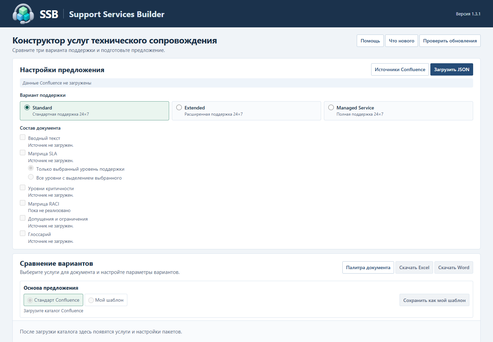

# Руководство пользователя Support Services Builder

**Версия 1.2.2 · 14 ноября 2026 г.**

## 1. Для чего нужен SSB

Support Services Builder помогает собрать предложение по техническому сопровождению. Вы выбираете вариант поддержки, настраиваете состав услуг и выгружаете предложение в Excel или Word. Каталог и настройки обрабатываются в вашем браузере.

## 2. Установка

Откройте HTTPS-ссылку на приложение, которую предоставил владелец SSB. Если в приложении видна кнопка **Установить приложение**, нажмите её и подтвердите установку. Установленный SSB открывается отдельным окном. На Windows его можно найти по названию **Support Services Builder** через поиск в меню «Пуск», если браузер зарегистрировал приложение в системе.

**В Google Chrome**

1. Откройте страницу SSB в обычном профиле Chrome.
2. Нажмите значок установки справа в адресной строке. Также можно открыть меню **⋮ → Трансляция, сохранение и отправка → Установить страницу как приложение**.
3. Подтвердите установку и откройте SSB из списка приложений. [Установка веб-приложений в Chrome](https://support.google.com/chrome/answer/9658361?hl=ru)

**В Microsoft Edge**

1. Откройте страницу SSB в обычном профиле Edge.
2. Нажмите значок установки в адресной строке или откройте **… → Другие инструменты → Приложения → Установить этот сайт как приложение**.
3. Подтвердите установку. В параметрах после установки можно выбрать, где закрепить приложение. [Установка веб-приложений в Edge](https://support.microsoft.com/en-us/edge/install-manage-or-uninstall-apps-in-microsoft-edge)

После первого открытия в сети проверьте, что SSB снова запускается без сети. Для резервной работы распакуйте автономный ZIP и откройте `index.html` из распакованной папки. Для обеих сборок достаточно браузера.

## 3. Первый запуск

1. Нажмите **Загрузить JSON** и выберите готовый файл, скачанный из Confluence. Для пробного запуска можно выбрать `examples/demo-confluence.json` из автономного ZIP.
2. Сверьте количество услуг в строке состояния под заголовком **Настройки предложения**. Дополнительные доступные разделы показаны в **Составе документа**. Кнопка **Источники Confluence** открывает настройки и сообщения импорта.

Настройки источников для готового файла необязательны. Чтобы добавить ссылку **Получить актуальные данные**, откройте **Источники Confluence**, укажите базовый адрес и метки нужных страниц, затем сохраните настройки. Все поля видны сразу. Ключ пространства можно указать, когда все нужные страницы находятся в одном пространстве. Окно закрывается кнопкой × и клавишей Escape. Введённые значения сохраняются при закрытии окна. Для хранения между запусками нажмите **Сохранить источники локально**. Браузер хранит настройки и черновик в текущем профиле и по адресу приложения.

## 4. Обновление каталога

1. Войдите в рабочий Confluence и скачайте актуальную выгрузку. Если в SSB настроена ссылка **Получить актуальные данные**, можно открыть через неё ответ REST и сохранить его как `.json`.
2. Если в ответе есть `_links.next`, сохраните следующие страницы отдельными файлами, пока ссылка на продолжение не исчезнет.
3. Нажмите **Загрузить JSON**. Выберите все файлы или добавляйте их по одному. Если SSB сообщает о недостающих страницах, загрузите продолжение.
4. Сверьте количество услуг в строке состояния и доступность разделов в **Составе документа**. При предупреждении или ошибке откройте **Источники Confluence**. Если источник неоднозначен, сверьте ID страниц в сообщении и оставьте в выгрузке нужную страницу или уточните выбор меткой.

Пока выгрузка неполная, рабочий каталог остаётся доступен. Если вы начали получать новую выгрузку, кнопка **Начать новую выгрузку** в окне **Источники Confluence** очищает только ожидающие страницы. При неудачном повторном импорте строка состояния показывает проблему последней загрузки и количество сохранённых ранее услуг. Подробности доступны в окне источников.

**Очистить загруженные данные** слева внизу окна **Источники Confluence** удаляет каталог, дополнительные источники и текущую конфигурацию из приложения и его черновика. После подтверждения дождитесь сообщения **Данные Confluence очищены**. Окно источников остаётся открытым. Личный шаблон, активная и собственная палитра и настройки источников сохраняются. Для продолжения закройте окно источников и загрузите JSON заново. После загрузки можно явно выбрать **Мой шаблон**.

**Очистить настройки источников** в окне источников удаляет только сохранённые адрес, пространство и метки, а также очищает поля формы. Каталог и текущее предложение сохраняются. Обе очистки требуют подтверждения, отмена и Escape сохраняют данные. Кнопка **Сохранить источники локально** сохраняет поля без предварительного подтверждения.

## 5. Создание предложения

1. В блоке **Основа предложения** выберите **Стандарт Confluence** или сохранённый **Мой шаблон**. Чтобы заново применить активную основу, нажмите на её выбранный вариант ещё раз.
2. Выберите **Standard — Стандартная поддержка 24×7**, **Extended — Расширенная поддержка 24×7** или **Managed Service — Полная поддержка 24×7**. В сравнении выбранный вариант помечен как **Предложение**.
3. В таблице включайте услуги для каждого пакета. Для включённой услуги укажите параметр, если он нужен, например количество часов.
4. Снимите отметку **Включить в документ**, чтобы исключить услугу из обоих документов целиком.
5. Откройте **Описание и условия**, чтобы сверить карточку и основную услугу. Модификация имеет собственный ID и настраивается отдельно.

Таблица занимает до 78% высоты окна и подстраивается при изменении его размера. Каталог прокручивается внутри таблицы, заголовки остаются видимыми. На узком экране доступна горизонтальная прокрутка.

## 6. Состав документа

В блоке **Состав документа** отметьте нужные разделы. Для Word и Excel используется один выбор. При применении **Стандарта Confluence** включаются все реализованные и доступные разделы, матрица SLA показывает выбранный пакет. **Мой шаблон** восстанавливает свой сохранённый состав. Уже открытый черновик сохраняет индивидуальный выбор разделов.

Вводный текст берётся из Confluence для выбранного варианта поддержки. Отсутствующий или пустой раздел недоступен, рядом указана причина. Если заполненная таблица не прошла проверку, откройте список сообщений импорта.

Для **Матрицы SLA** выберите состав. **Только выбранный уровень поддержки** показывает таблицу пакета предложения. Для **Всех уровней с выделением выбранного** доступны **Отдельные таблицы по уровням поддержки** и **Одна сравнительная таблица**. В таблице отдельного пакета пять временных показателей идут строками, а уровни критичности 10, 20, 30 и 80 — столбцами. В сравнительной таблице каждый пакет занимает свой столбец. В зависимости от представления выделяется таблица пакета предложения или его столбец. **Уровни критичности** можно включить отдельно. В Word они выводятся в таблице. **Матрица RACI** пока недоступна.

## 7. Скачивание документов

Кнопка **Палитра документа** в разделе **Сравнение вариантов** открывает предпросмотр оформления Word и Excel. В режиме **Базовая** используются корпоративные синий и зелёный с белым текстом. В режиме **Своя** выберите цвета образцами или введите HEX-коды. Для каждого заголовка можно оставить белый текст, включить **Авто** или указать свой цвет. Если контраст низкий, SSB покажет предупреждение рядом с предпросмотром.

Активный вариант и последние корректные настройки собственной палитры сохраняются автоматически в этом браузере и в черновике, без отдельной кнопки. Базовая палитра не редактируется. Переключение на **Базовая** сохраняет собственные цвета; при возврате на **Своя** они восстанавливаются, включая режимы и HEX цветов текста. Закрытие окна, повторный импорт, выбор основы и сохранение личного шаблона не сбрасывают палитру. Незавершённый HEX не заменяет последнее корректное значение. При ошибке сохранения SSB показывает предупреждение; до её устранения не рассчитывайте на сохранение между запусками.

Word и Excel используют название **Предложение по техническому сопровождению**. В приложении хранится одна текущая конфигурация предложения.

- **Скачать Excel** создаёт книгу с листами «Описание услуг» и «Предложение». На втором листе ID и название ведут к описанию на первом листе. Вводный текст размещается на листе «Предложение». Для других включённых разделов создаются отдельные листы.
- **Скачать Word** создаёт документ со сравнением вариантов и описаниями и условиями по включённым услугам. Включённый вводный текст размещается перед сравнением. Остальные отмеченные разделы следуют после описаний.

Найдите файлы в загрузках браузера. Перед отправкой клиенту проверьте выбранный пакет, состав, параметры и вводный текст.

## 8. Мой шаблон и черновик

- **Стандарт Confluence** восстанавливает состав и параметры услуг из загруженного стандарта, выбирает Standard, включает все доступные реализованные разделы и режим SLA **Только выбранный уровень поддержки**.
- **Мой шаблон** восстанавливает сохранённые пакет, услуги, параметры, признаки включения в документ, состав разделов и представление SLA.
- **Сохранить как мой шаблон** сохраняет текущую конфигурацию в браузере. Первое сохранение выполняется сразу. Обновление существующего шаблона требует подтверждения замены.

Индивидуальные изменения текущего предложения автоматически сохраняются в черновике. Чтобы заменить их настройками основы, подтвердите применение в диалоге. Сохранённый шаблон изменяется только при явном сохранении. Палитра документа остаётся независимой. После обновления каталога настройки сопоставляются по ID услуг, новые услуги получают значения актуального стандарта. Отсутствующие дополнительные разделы недоступны для экспорта.

Автосохранение работает без сообщений после каждой правки. При следующем открытии приложение вернёт фактическое состояние текущего предложения. Ошибки сохранения остаются видимыми до устранения. Старые настройки менеджера доступны как личный шаблон с начальными значениями пакета и состава документа. Старые черновики сохраняют свои настройки, прежние клиент и название игнорируются при экспорте.

Шаблон и черновик хранятся в текущем профиле браузера и по адресу приложения. Очистка данных сайта удаляет их. Перед переносом сохраните нужные документы.

## 9. Обновления приложения

Версия показана в шапке. В установленном приложении новая версия проверяется в фоне. Нажмите **Проверить обновления**, чтобы проверить вручную. Когда появится **Установить обновление**, завершите текущую операцию и подтвердите перезапуск. SSB сначала сохраняет предложение. После открытия новой версии проверьте надпись о восстановлении черновика и выбранный пакет.

Откройте **Что нового**, чтобы прочитать изменения текущей версии. Если браузер не подтвердил сохранение, приложение предложит отложить перезапуск.

При переходе с 1.1.0 сохранённые настройки и черновик открываются в том же профиле браузера. Вводный текст формируется из Confluence для выбранного варианта поддержки. Текст, введённый в локальном редакторе 1.1.0, можно сохранить в документе Word или Excel перед обновлением.

## 10. Частые проблемы

**JSON не загружается.** Проверьте расширение файла и его содержимое. Файл со страницей входа или HTML нужно пересохранить после входа в Confluence.

**Каталог неполный.** Сохраните и загрузите остальные страницы из `_links.next`. Если ссылки уже нет, проверьте пространство, метки и права просмотра.

**Услуги не отображаются.** Откройте сообщения импорта и проверьте, что JSON содержит карточки с содержимым страниц и полями Page Properties. Сверьте число карточек с источником.

**Документ не формируется.** Загрузите каталог и исправьте подсвеченные параметры. Проверьте папку загрузок и разрешение браузера на скачивание.

**Шаблон или черновик не сохраняются.** Проверьте, что вы используете обычный профиль и браузер разрешает хранение данных сайта. Сохраните нужные документы. Если ошибка возникла после открытия второй вкладки, продолжайте в той вкладке, которая сохранила черновик первой.

**Обновление не устанавливается.** Проверьте сеть и статус сохранения черновика. Закончите импорт или экспорт, закройте лишние окна SSB и повторите проверку обновлений. При ошибке загрузки продолжайте в открытой версии.
